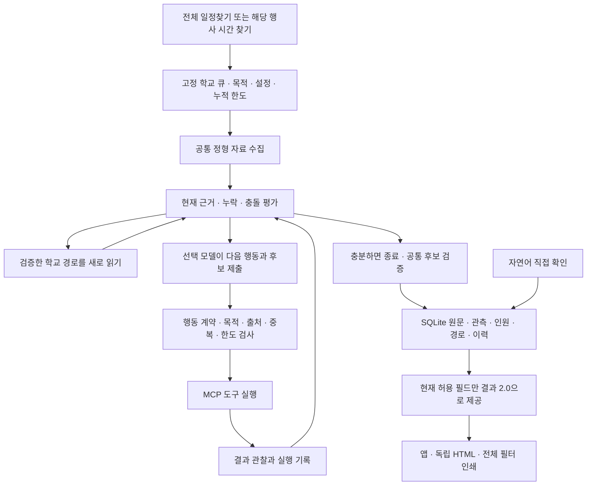

# 구조와 선택 이유

현재 앱은 **학교별 조사 Agent + 코드 기반 실행 관리자** 구조다. 하나의 조사 구현에 학교 종류·조사 목적·현재 행사·재사용 경로·공개 근거를 전달한다. 학교마다 별도 프로그램이나 감독용 LLM을 만들지 않는다. 사용자에게는 조사·직접 기록·일정표를 제공하고 근거와 실행 이력은 SQLite에 보관한다.

## 조사 목적과 실행 흐름

`date_count`는 전체 대상 학교의 날짜·인원을 조사한다. 초중고는 NEIS 전체 시즌 학사일정과 학교알리미 인원을 우선 조회한다. 정형 근거가 충분하면 모델을 초기화하지 않고 종료한다. 기본 조사에서는 시각 탐색 목적의 별도 검색을 허용하지 않지만 날짜를 찾던 동일 원문에 본식 시각이 있으면 함께 저장한다.

`time`은 단일 학교·시즌·현재 행사 UUID와 날짜에 고정한다. 해당 행사의 본식 시각을 찾으며 다른 행사나 변경 전 날짜의 시각을 붙이지 않는다. 작업 생성과 재개에서 같은 활성 작업 검사와 설정 일치 검사를 사용한다.

대학은 공식 학사일정·대표 행사 공지·캠퍼스 자료를 조사한다. 학위복 대여·학위증 수령이나 학과 행사를 학교 대표 본식으로 채택하지 않는다. 같은 대표 행사 안의 학부·대학원은 같은 행사로 묶고, 실제 구분되는 회차·캠퍼스는 유지한다.

## Agent와 코드의 경계

`ResearchRunner`는 확보한 원문을 평가하고, 검증된 학교 경로를 읽은 뒤 부족하거나 충돌한 필드가 남으면 선택 모델에 다음 행동을 요청한다. 모델은 `AgentDecision` 계약의 `search_web`, `fetch_document`, `stop` 행동과 원문 후보·인원 후보·선택 이유를 제출한다. 실행기는 결과 관찰과 이전 행동을 다음 결정에 다시 전달한다. 계획 문장만 저장하거나 미리 정한 검색어를 순서대로 실행하는 흐름이 아니다.

모델에 전달하는 긴 메뉴·달력 숫자 격자는 필요한 실제 연속 원문 구간으로 줄인다. 생성 응답의 짧은 근거 블록 ID를 원래 문서·분절·연속 인용에 다시 연결한 뒤 내부 `AgentDecision`으로 검사한다. 모델이 원문을 재작성해 문맥을 만들어내는 문제와 긴 UUID 복사 오류를 줄이기 위한 선택이다. 정규 날짜·시각·인원은 여전히 모델의 미승인 제안이며, 원래 제안과 탈락한 필드의 이유도 내부에 남긴다.

코드는 행동 계약, 조사 목적, 공식 URL, 중복 검색·문서 요청, 자료원 호출 수, 문서 수, 모델 호출·토큰·시간 한도를 검사한다. 호출 전 예약과 실제 사용량 정산, 중단 체크포인트를 사용한다. 잘못된 행동은 실행하지 않고 관찰 결과로 돌려주며 취소·재개 때 누적 사용량을 초기화하지 않는다. 모델 장애 시 다른 백엔드로 자동 전환하지 않는다.

`investigation_traces`에는 학교·시즌·목적·대상 행사와 선택 행동·도구 관찰·종료 이유를 기록한다. 정형 자료로 끝난 조사도 명시적인 종료 기록이 남는다. 이 기록은 사용자 기본 화면에 표시하지 않는다.

## 사실을 승인하는 방법

정형 파서는 NEIS·명시 공지·학사력에 등록한 규칙으로 후보를 만든다. 모델 후보도 같은 저장 경로를 통과한다. `grounded_notice`는 기존 파서가 같은 값을 재추출했는지 대신 실제 문맥·필드 인용과 학교·학년도·행사·날짜·시각 역할을 검사한다. 키 힌트가 없는 정상 모델 후보도 근거를 확인한 후 서버가 기존 행사와 연결한다.

기관명과 행사 주어, 본식 날짜와 시각, 문서 단위가 일치해야 한다. 식전 공연·촬영·입장·대여 시각을 본식 시작으로 사용하지 않는다. 날짜만 지원되면 시간은 보류하고 날짜를 게시한다. 취소·미실시·연기와 같은 변경은 같은 기관·학년도·행사에 연결해 이전 값의 현재 사용을 통제한다.

월별 달력은 같은 분절에서 날짜 행 직전의 연월 제목과 그 날짜 바로 다음의 본식 제목을 연결한다. 학년도와 달력 연도를 혼동하거나 같은 페이지의 다른 행사 날짜를 가져오면 거절한다. 대학의 ‘졸업식’과 ‘학위수여식’ 분류는 같은 대표 행사의 동의어로 정규화하되 회차·캠퍼스 차이는 유지한다. 이전 중복을 연결할 때 인원 관측도 함께 이동하며 원문·이력은 보존한다.

원문 해시·공식 관계·실제 인용·기간·필드별 규칙 버전은 저장과 조회에서 검사한다. 모델의 자신감이나 여러 모델의 동의를 승인 근거로 삼지 않는다. 이러한 검사는 명확한 관계를 가진 공개 문서를 처리하지만 모든 자연어 의미 오류를 제거하지는 못한다. 모호한 단위·지원하지 않는 형식은 보류하고 추가 조사 또는 직접 확인이 필요하다.

## 인원과 학교별 경로

`CountClaim`에는 원문 ID, 값, 기준 학년도, 인원 종류, 학년, 단위, 인용, 자료원 식별을 보관한다. 초등 6학년·중고등 3학년 재학생 수와 대학 대표 본식 졸업자 수를 구별한다. 학교알리미 API와 공개 표는 학교 코드·주소·구 코드·기준 학년도·표의 학년 열을 공통 검증기가 다시 확인한다. 전체 학생 수를 졸업 학년 인원으로 바꾸거나 미발견을 0명으로 만들지 않는다.

`count_observations`는 허용·기각 후보와 판정을 함께 보존한다. 조회 시 원문·재확인 상태를 다시 검사한다. 한 경로가 실패해도 독립적인 같은 값의 근거가 유효하면 유지하고, 유효한 인원이 서로 다르면 보류한다. 대학 인원은 단 하나의 현재 허용 행사에만 연결하며 날짜나 행사 관계가 맞지 않으면 사용하지 않는다.

`collection_routes`는 공식 홈페이지와 실제 활용할 수 있는 학사일정·공지 목록을 저장한다. 학교, URL, 목적, 읽기 방식, 마지막 성공·시도, 실패 이유와 원문 ID를 관리한다. 공식성·성공적인 읽기·목록의 공식 링크를 서버가 다시 검사한다. 개별 시즌 공지는 사실 원문으로 남기고 재사용 목록으로 승격하지 않는다.

`route_attempts`에는 실패도 남는다. 미발견·접근 실패·지원하지 않는 형식·다른 학년도를 구분한다. 실패한 경로의 마지막 성공 이력을 지우지 않되 현재 조사에서는 다시 읽어야 한다. 과거 경로 성공이나 검색 실패를 올해 사실 또는 미공개의 증거로 삼지 않는다.

## 직접 기록과 현재 출력

자연어 직접 기록은 외부 모델에 보내지 않고 로컬에서 날짜·시간·학교·확인 방법·실제 확인시점을 해석한다. 원문과 정규값, 질문과 답변, 변경 이력을 저장한다. 명확한 내용은 먼저 기록하고 모호하거나 기존 값과 충돌하는 필드만 질문한다. 기존 시간 보완은 같은 UUID를 갱신한다. 자동 조사는 보호된 수기 값을 임의로 덮어쓰지 않는다.

사용자 결과 2.0은 날짜·학교명·시간·졸업인원수·학교 주소의 다섯 열이다. 현재 허용 필드만 제공하고 공란으로 부족한 정보를 표시한다. 학교 링크는 확인된 공식 홈페이지다. 검증 상태·확인시점·정책·기술 사용량은 내부에 유지한다.

앱과 저장 HTML은 같은 필터 스크립트를 사용한다. 학교명·구·하루 조건을 함께 적용하고 복수 행사일의 각 날짜를 검색할 수 있다. 화면은 20행씩, 인쇄는 현재 필터의 전체 행을 보여준다. 날짜 색은 첫 행사일로 결정하므로 페이지 이동으로 바뀌지 않으며 흑백 인쇄에는 경계선이 남는다. HTML에는 CSS·JS를 내장하고 외부 요청 없이 조회·인쇄한다. 학교별 조사 버튼은 실행 앱에만 있다.

## 저장·설정·보호

SQLite WAL·외래키·짧은 거래를 사용한다. 외부 응답을 기다리는 동안 쓰기 거래를 잡지 않는다. 핵심 저장 계약 4.0 위에 `experience_schema=2` 확장을 적용하며 기존 파일은 백업 후 변경한다. 자연어·행사 연결 이력에 인원·경로·실행 추적 테이블을 더한다. 지원하지 않는 버전은 파일을 보존한 채 거절한다.

새 규칙 적용 시 기존 원문을 로컬에서 다시 평가하지만 인터넷에서 새로 읽은 것으로 확인시점을 바꾸지 않는다. 과거 행사·관측·수기·원문을 삭제하지 않으며 자료원별 동일 행사의 연결 이력도 보존한다. 새 HTML을 만든 뒤 현재 파일 포인터를 갱신하고 이전 표현 파일은 그대로 보관한다.

설정은 기존 기본값·선택 모델 profile·비어 있지 않은 환경 설정 병합을 유지한다. 선택한 Ollama/OpenAI만 필요할 때 초기화하며 사적 수기와 이미지의 외부 전송 정책을 유지한다. 학교알리미 키와 검색·NEIS 키는 비밀 설정으로 보관하고 출력·커밋하지 않는다. 학교알리미 소재 구 코드는 공식 식별 자료로 처리한다.

## 모듈과 검증

| 모듈 | 책임 |
| --- | --- |
| `jobs.py`, `research.py`, `tool_boundary.py` | 작업 큐·목적·한도·취소·재개·학교별 결정/관찰 반복·MCP |
| `providers.py`, `providers_student.py`, `registry.py`, `official_registry.py` | 실제 일정·인원·학교 명부·공식 페이지 읽기 |
| `identity.py`, `rules.py`, `claims.py`, `publication.py` | 행사 연결·규칙·모델/인원 후보 관계 검사·현재 사용 권한 |
| `storage.py`, `research_records.py`, `migrations.py` | 거래·원문/인원/경로/실행 이력·자동 백업 |
| `natural.py`, `manual.py` | 직접 확인·수기 보호·필요한 질문·수정 이력 |
| `results.py`, `exporting.py`, `static/` | 공통 결과·오프라인 필터·페이지·인쇄·간단한 앱 |
| `config.py`, `configuration.py`, `api.py` | 설정 보호·선택 백엔드·API 계약과 요청 경계 |

실제 학교 명부 339개와 현재 시즌 건국초 날짜·인원 정형 성공을 확인했다. 이는 모델 판단이 필요한 대학 조사 전체의 성공을 뜻하지 않는다. 모델 실행·실제 원문·브라우저의 증빙과 남은 범위는 [최신 검증 기록](RESEARCH_V2_VALIDATION.md)에서 구분한다.
