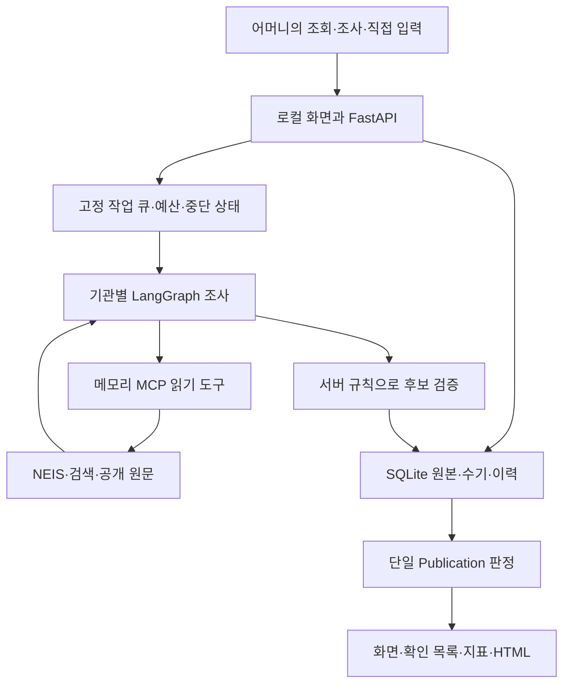

# 광주 졸업식 일정 도우미의 구조

이 프로그램은 조사에서 얻은 **후보**, 근거로 **확인한 값**, 꽃다발 판매 준비에 **현재 사용할 수 있는 값**을 구분한다. 날짜만 확인되면 날짜를 제공하고, 실제 시작 시각이 부족하면 빈칸과 확인 사유를 남긴다. 프로그램을 종료해도 조사·직접 입력 기록은 SQLite에 보존되며 저장한 HTML 일정표는 별도로 열 수 있다.

이 문서는 현재 코드의 작동 원리와 선택 이유를 설명한다. 실제 자료원 연결, 정상·실패 검사, 브라우저·프로세스 검증 결과는 [검증 기록](VALIDATION.md)을 기준으로 판단한다. 구현된 경로가 있다는 사실과 그 경로에서 실제 기관의 정확한 일정을 확보했다는 사실은 다르다.

## 전체 흐름

모델은 읽은 원문에서 후보 값과 인용을 제안할 수 있다. 모델이나 웹 문서가 DB를 직접 수정하거나 판매 준비 여부를 승인하는 도구는 제공하지 않는다. 최종 게시 여부는 서버가 저장 근거를 다시 대조해 계산한다.

## 모듈과 책임

| 모듈 | 맡는 일 |
| --- | --- |
| [launcher.py](../app/launcher.py), `__main__.py` | `python -m app` 진입점, 같은 저장소의 중복 실행 방지, loopback 포트 확보, 서버 준비 후 브라우저 열기, 종료 정리 |
| [config.py](../app/config.py), [configuration.py](../app/configuration.py) | 기본값·선택 모델 profile·환경변수 병합, 비밀 분리, 허용 범위 검사, 작업 재개 설정 해시 |
| [api.py](../app/api.py), [static](../app/static/index.html) | 화면과 API 연결, 입력·응답 계약, 실행별 토큰·Host·Origin 검사, revision 경합, 요청 재전송 처리 |
| [domain.py](../app/domain.py), `domain.schema.json` | 같은 JSON Schema로 Python 서비스와 Pydantic 요청·응답 검사. 임의 추가 필드나 잘못된 날짜를 거절 |
| [jobs.py](../app/jobs.py) | 고정 대상 큐, 동시 실행, 기관·구간·전체 예산, 호출 전 예약, checkpoint, 멈춤·취소·재시작 |
| [research.py](../app/research.py) | 기관별 LangGraph, 초기 수집→후보 검토→추가 조사→종료 |
| [tool_boundary.py](../app/tool_boundary.py) | 같은 프로세스 안의 실제 MCP 세션과 공개 읽기 도구, 기관·시즌 범위 및 도구 입출력 계약 |
| [providers.py](../app/providers.py) | NEIS·Tavily·HTML/PDF·선택 모델 연결, 공개 URL 검사, HTTP 제한과 실패 분류 |
| [rules.py](../app/rules.py), [publication.py](../app/publication.py) | 버전이 고정된 원문 검증 규칙, 필드별 ValueCheck, 일반 조회와 현재 사용의 유일한 최종 판정 |
| [storage.py](../app/storage.py), [schema.sql](../app/schema.sql), [manual.py](../app/manual.py) | SQLite 거래, 기관·시즌·문서·관측·평가·수기·이력, 읽기 snapshot, 직접 입력 보호 |
| [registry.py](../app/registry.py), [official_registry.py](../app/official_registry.py), [registry_assets.py](../app/registry_assets.py) | 공식 명부 수집·파일 검사·미리보기·중복 연결과 서버가 검토한 공식 홈페이지 관계 |
| [exporting.py](../app/exporting.py) | 판정된 같은 snapshot을 안전한 독립 HTML로 표현 |

현재 실행 구조는 한 PC의 한 서버 프로세스에 맞춘다. Redis·별도 작업 서버·원격 DB 없이 설치와 백업을 단순하게 유지하는 선택이다. 여러 사용자가 동시에 편집하거나 여러 서버가 같은 DB를 공유하는 서비스 배포는 별도 설계가 필요하다.

## 저장소가 원본과 이력을 관리한다

기본 데이터 경로는 프로젝트 안 `data/live/`와 `data/demo/`이며, `APP_DATA_DIR`를 지정해도 그 아래에 모드별 폴더를 나눈다. 각 폴더에는 `graduation.sqlite3`, 백업, HTML 출력이 저장된다. 코드·정적 화면·검토된 명부 같은 앱 자산과 사용자가 쌓은 데이터를 구분한다. `reference/`의 인계 원본을 앱 실행 중 수정하지 않는다.

SQLite를 선택한 이유는 별도 DB 서버 없이 기록을 보존하고 하나의 일관된 백업을 만들 수 있기 때문이다. WAL, 외래키, 잠금 대기시간을 사용하며 쓰기는 짧은 트랜잭션으로 처리한다. 외부 요청을 기다리는 동안 DB 쓰기 잠금을 계속 유지하지 않는다. 같은 요청 안의 중첩 저장 작업은 같은 연결을 사용해 수기 변경과 revision, 멱등성 기록을 함께 확정한다.

주요 저장 단위는 다음과 같다.

| 기록 | 의미 |
| --- | --- |
| 기관·외부 식별자·명부 snapshot | 어떤 공식 목록의 어느 기관인지, 자료의 범위·기준일·완전성, 명부와 연결된 원본 행 |
| 시즌·행사 | 대상 학년도와 조사 기간, 같은 기관 안에서도 구분해야 할 과정·학과·회차·캠퍼스 |
| 문서·관측 | 읽은 출처, 취득·읽기 범위, 본문 구간, hash와 그 문서에서 추출한 후보 |
| 평가·수기·감사 이력 | 서버가 필드별로 어떤 근거를 채택했는지, 사람이 무엇을 언제 확인하거나 변경했는지 |
| 작업·구간·기관 항목·예약 | 고정된 조사 대상, 처리 상태, 누적 사용량, 미확인 응답 비용 |
| 출력 기록 | 어느 콘텐츠 revision과 게시 정책으로 만든 HTML이 현재 파일인지 |

관측을 기각하거나 수기 지정을 해제해도 이전 기록을 삭제하지 않는다. 오류의 원인을 설명하고 다시 판단하기 위해서다. 그 대신 DB와 출력 파일이 계속 늘어날 수 있으며, 보존 기한과 자동 정리 기능은 아직 제공하지 않는다.

내용이 바뀌면 `content_revision`이 증가한다. 화면의 오래된 편집 요청은 예상 revision이 다르면 409로 거절한다. 사용자가 다시 누른 동일 생성 요청은 멱등성 키로 기존 결과를 돌려준다. 이를 통해 자동 저장과 직접 입력이 겹칠 때 다른 변경을 조용히 덮어쓰는 일을 막는다.

## 조사 Agent는 정해진 권한 안에서 반복한다

기관별 LangGraph는 다음 흐름으로 실행된다.

1. 학교는 NEIS의 기관 코드와 전체 조사 기간으로 학사일정을 읽는다. 현재 시즌의 저장 근거와 확인된 공식 홈페이지도 다시 읽는다.
2. 정형 규칙으로 먼저 후보를 추출한다. 지원하는 HTML/PDF 원문이 있고 필요할 때 선택 모델을 호출한다.
3. 날짜·실제 시작 시각이 부족하면 정해진 방식의 새 검색어와 발견한 공식 링크를 선택한다.
4. 새 자료를 읽고 후보를 다시 검토한다. 충분한 후보, 더 탐색할 경로 부재, 또는 한도 도달 시 종료한다.

현재 다음 탐색을 고르는 로직은 Python으로 작성한 제한된 규칙이다. LLM이 임의의 도구나 실행 코드를 만드는 방식은 아니다. LangGraph는 이 반복과 조건부 분기를 명확히 나타내며, 모델은 필요한 문서의 후보 추출에 한정한다. 동작을 재현하고 실패 이유를 설명하기 쉽지만, 새로운 사이트 구조나 복잡한 공지 형식을 유연하게 해석하는 범위는 좁다.

MCP는 `get_school_calendar`, `search_public_web`, `read_public_document`라는 읽기 도구 세 개와 고정 정책 리소스를 제공한다. 실제 MCP 클라이언트와 서버가 메모리 스트림으로 연결되어 요청·응답을 주고받는다. 외부에 MCP 서버를 열거나 별도 프로세스를 배포하지 않는다. 따라서 프로토콜·권한 경계는 있지만 운영체제 수준의 격리 환경은 아니다.

도구 세션은 기관과 시즌에 묶인다. 학사일정 요청이 다른 기관이나 다른 조사 기간을 지정하면 거절한다. 검색 요약은 원문 주소를 찾는 데 사용하며 일정 근거로 승격하지 않는다. 도구 오류에 예산·취소 신호가 포함되면 일반적인 자료원 실패로 바꾸지 않고 작업 실행기에 전달한다.

LangGraph의 메모리 상태 자체를 영속 체크포인터에 저장하지는 않는다. 완료한 문서·후보를 외부 호출 사이에 `Meter.checkpoint`로 SQLite에 저장한다. 재개는 저장한 기관 큐와 근거를 읽어 기관 조사를 다시 시작하므로 일부 탐색을 반복할 수 있지만, 이미 저장한 결과와 누적 비용은 유지한다.

## 수집 성공과 사실 확인은 별개다

HTTP 200 응답도 삭제된 게시물이나 오류 화면일 수 있다. reader는 연결 성공, 본문 읽기, 기관 일치, 졸업식 관련 본문 여부를 구분해 기록한다. 공개 URL은 사설 주소·내부망으로 연결되지 않도록 검사하고 DNS 검증 후 연결 IP를 고정한다. 리디렉트도 다시 검사하며 TLS 검증을 끄지 않는다.

공식성은 이름이 비슷하거나 사용자가 홈페이지 주소를 적었다는 이유만으로 생기지 않는다. 인증 NEIS의 기관 관계 또는 서버가 원본과 대응을 검토한 명부 자산으로 확인한다. 파일 import의 문자열·hash 주장만으로 새로운 공식 관계를 승인하지 않으며, 검토된 입력 전체와 정확히 일치하는 경우에만 서버의 관계를 연결한다. 다른 호스트로 이동한 홈페이지는 추가 확인이 필요하다.

지원하는 원문은 정형 NEIS, 일반 HTML, 텍스트를 추출할 수 있는 PDF다. 현재 reader는 JavaScript 브라우저 실행, 이미지·스캔 PDF의 OCR, HWP/HWPX 해석을 제공하지 않는다. 텍스트 PDF도 페이지·문자 한도 안에서 읽고 부분 읽기를 전체 읽기로 표시하지 않는다.

선택 모델은 Ollama 또는 OpenAI를 필요할 때만 호출한다. 연결이 없거나 출력이 잘못되어도 다른 모델이나 가상값으로 자동 전환하지 않는다. 실제 공개 구간과 후보용 스키마만 보내며, 수기 메모·연락 이력·비밀키를 후보 입력으로 넣지 않는다. 원격 Ollama 및 cloud 태그 모델도 외부 문서 전송 허용 검사 대상이다. 모델 호출 성공과 JSON 구조 통과는 원문의 사실 확인을 대신하지 않는다.

## 한 개의 Publication이 화면과 HTML을 결정한다

저장된 자동 상태가 `official_confirmed`라고 되어 있어도 그대로 신뢰하지 않는다. 게시 계산은 기관·시즌·행사·관측·문서 버전·인용·필드·허용 규칙 버전을 다시 연결한다. 날짜, 실제 시작 시각, 장소, 행사 상태는 각자 근거를 가진다.

운영 규칙은 `규칙ID@버전`으로 활성화한다. 같은 ID의 코드 버전이 바뀌면 이전 허용값만으로 새 버전을 승인하지 않는다. 현재 NEIS 규칙과 제한된 명시 공지 규칙이 있으며, 적용 근거와 범위는 [규칙 목록](../config/rule-catalog.json)에 남긴다. 새 규칙에는 정상 사례와 혼동·변경·잘못된 인용 같은 반례 검사가 함께 필요하다.

`calculate_publication`이 만드는 결과는 두 용도를 구분한다.

| 용도 | 판단 |
| --- | --- |
| 일반 일정표 | 과거에 확인한 값을 근거·확인시점·재확인 실패 표시와 함께 보여줄 수 있는가 |
| 현재 날짜·시간 사용 | 해당 필드를 지금 사용할 조건을 충족하는가 |
| 판매 준비 목록 | 현재 날짜와 실제 시작 시각을 모두 사용할 수 있는가 |

예를 들어 날짜가 확인되고 시간이 없으면 날짜만 일정표에 나오고 판매 준비는 false다. 원문 재확인에 실패하면 과거 확인값은 일반 조회에 남을 수 있지만 현재 사용은 보류할 수 있다. 날짜를 바꾸면 예전 시간의 `bound_date`가 맞지 않아 새 날짜와 자동으로 결합되지 않는다. 월만 알려진 계획을 임의의 일자로 바꾸지도 않는다.

명시적 취소나 행사 정체성의 미해결 문제는 전체 행사 사용을 보류한다. 시간만 충돌한 경우에는 독립적으로 확인한 날짜까지 불필요하게 지우지 않는다. 화면·집계·HTML은 이 결과를 소비하며 각자 별도의 게시 규칙을 만들지 않는다. 읽기 snapshot 안에서 같은 시점의 행사와 집계를 계산하므로 출력하는 동안 자료가 바뀌어도 서로 다른 revision을 섞지 않는다.

학사력 변경 공지는 좁은 날짜 변경 문법을 지원한다. 같은 학년도·회차·대상에서 원문에 명시된 이전 날짜가 이전 관측과 일치할 때만 그 필드의 대체 관계를 적용한다. 이전 관측을 삭제하거나 기각하지 않고 필드별 감사 이력으로 남긴다. 다른 필드가 여전히 쓰는 관측은 유지하며, 새 날짜에 예전 시간을 묵시적으로 붙이지 않는다. 대체 근거가 기각되면 남은 근거로 다시 계산하고, 순환하는 변경 주장은 충돌로 남긴다. 모든 변경 공지 표현을 지원하지는 않는다.

이 방식은 판정 근거를 추적하기 쉽고 임의 확정을 줄인다. 반면 공식 공지라도 지원하지 않는 표현이면 유효한 일정을 보류할 수 있다. 확인 목록에 질문과 사유를 남겨 추가 조사나 전화 확인으로 이어지도록 한다.

## 직접 입력은 자동 조사와 함께 보존한다

수기 작업의 의미를 구분한다.

| 작업 | 결과 |
| --- | --- |
| `set` | 직접 확인하거나 기록한 값을 보호된 사용자 지정으로 저장 |
| `clear` | 해당 필드를 의도적으로 비운 상태를 보호 |
| `release` | 사용자 지정을 해제하고 남아 있는 자동 근거로 다시 판단 |
| 생략 | 그 필드의 기존 지정 유지 |
| `acknowledge` | 차이를 읽었다고 기록. 충돌 해결이나 게시 재개를 뜻하지 않음 |

입력한 시각과 실제 확인한 시각을 구분한다. 확인시점이 미상인 기록은 보관하되 오늘 확인한 것으로 만들지 않는다. 전화·문서 확인으로 게시하는 경우 실제 확인시점과 방법을 사용하며, 기존 충돌을 해결하려면 현재 fingerprint, 충돌 감지 뒤의 확인시각, 확인 근거 메모가 필요하다. 다른 버전의 문서나 다른 기관 자료를 확인한 근거로 연결하지 않는다.

새 웹 자료가 수기값과 달라도 수기를 덮어쓰지 않는다. 두 기록과 차이를 보존해 사용자가 재확인하게 한다. 동일 충돌의 재조회 시간만 갱신되었다고 이전의 정당한 해결을 취소하지 않으며, 실제 근거가 달라진 새 충돌이면 다시 확인한다. 앱은 사용자가 전화로 확인했다는 기록을 관리하지만 전화 통화 사실을 독립적으로 인증하지는 않는다.

## 예산은 실행 전에 예약하고 누적한다

작업 시작 시 대상 기관을 고정한다. 이후 기관을 추가하거나 화면의 페이지가 바뀌어도 진행 중인 큐를 바꾸지 않는다. `initial`, `recheck`, `missing_only`는 저장 상태와 확인 목록을 기준으로 다른 대상을 고르며, 한 기관의 다른 행사가 미해결이면 조사 대상에서 빠지지 않는다.

외부 호출은 기관·현재 구간·전체 작업의 남은 한도를 같은 트랜잭션에서 확인한 뒤 예약한다. HTTP 재시도와 리디렉트도 실제 요청 횟수에 포함한다. 응답 후 실제 사용량을 알면 예약 차액을 정산한다. 토큰 사용량이 없거나 응답이 유실되면 `charged_unknown`으로 남기고 예약량을 유지한다. 미확인 비용을 실제 0으로 바꾸지 않는다.

전체 활성시간은 **각 기관에서 실제 실행한 시간의 초 단위 올림 합**이고, 실행 구간의 제한시간은 별도의 wall clock이다. 동시 실행이 같은 잔여시간을 중복 사용하지 않도록 기관 시작 때 시간 상한을 먼저 예약한다. 정상 종료하면 실제 측정값으로 정산하고, crash로 측정할 수 없으면 예약분을 보수적으로 유지한다. PC가 꺼져 있던 시간을 추가 과금하지 않는다. 취소 전달과 정리 시간·초 단위 올림 때문에 최종 측정값이 한도를 조금 넘을 수 있으며, 이를 낮춰 보고하지 않고 이후 실행을 제한한다.

멈춤은 신규 호출을 막고 진행 중 결과를 정리한 뒤 재개 가능한 상태로 남긴다. 취소는 영속 의도다. 취소 후 늦은 응답·checkpoint는 저장하지 않으며 재시작해도 cancelled로 복구한다. 완료·실패한 기관을 resume으로 자동 재실행하지 않는다. 전체 예산을 소진한 작업은 한도를 명시적으로 늘려야 이어갈 수 있다.

저장 오류가 난 기관의 사용량 정산은 결과 저장과 분리한다. 한 기관 실패로 비용을 잊거나 다른 기관 전체를 멈추지 않기 위해서다. 미확인 비용은 실제보다 크게 남을 수 있으므로 안전한 한도 관리와 정확한 비용 추정 사이의 절충이다. 금액 환산을 위한 가상 단가는 넣지 않는다.

## 설정 변경·백업·이전 정책의 제한

설정 우선순위는 기본값 → 최종 선택 모델의 profile → 비어 있지 않은 `.env` → 프로세스 환경변수다. 명시한 false와 0은 미입력으로 버리지 않고 범위를 검사한다. 키는 메모리의 별도 사전에 보관하며 작업 snapshot·일반 JSON·HTML에는 넣지 않는다. 기존 시즌은 DB가 관리하므로 설정의 새 시즌 기본값이 이전 시즌을 덮어쓰지 않는다.

작업은 시작 때 수집·모델·전송·게시 설정 해시를 저장한다. 관련 설정이 바뀐 뒤 재개하면 외부 연결 전에 `settings_changed`로 거절한다. 키 교체나 UI 포트 변경은 이 해시와 무관하다. 해시는 이전 설정 전체를 복원하는 자료가 아니므로 이전 설정을 사용자가 복원하거나 기록을 유지한 새 작업을 만들어야 한다.

SQLite backup API로 일관된 DB 백업을 생성하고 다운로드할 수 있다. 복원용 화면이나 자동 복원 절차는 구현하지 않았다. 4.0이 아닌 DB는 덮어쓰지 않고 `migration_required`로 거절한다. 이전 DB를 4.0으로 변환하는 migration, 없는 증명 보완, 이전 자동값 재승인은 제공하지 않는다.

이전·미상 게시 정책의 HTML은 현재 일정 URL로 제공하지 않는다. 파일을 보관하고 있더라도 현재 정책으로 근거를 다시 평가해 새로 생성해야 한다. 백업은 DB 내용이며 HTML 파일·설정·키까지 묶은 전체 환경 복구 패키지는 아니다.

## HTML은 저장한 시점의 독립 일정표다

HTML 생성은 한 번의 읽기 snapshot에서 얻은 Publication을 사용한다. 날짜·시간·장소를 모델에게 다시 작성시키지 않는다. 생성시점, 콘텐츠 revision, 정책, 근거 링크, 필드 확인시점과 재확인 상태를 함께 출력한다. 기본값에서는 사적 수기 메모를 제외하며 사용자가 포함을 선택한 경우에만 넣는다.

파일 이름에는 revision과 고유값을 넣고 새 파일을 만든 뒤 DB의 현재 파일 포인터를 바꾼다. 파일과 DB를 한 트랜잭션으로 묶을 수 없기 때문에 선택한 방식이다. DB 갱신이 실패해도 마지막 정상 파일을 덮어쓰지 않는다. 대신 참조되지 않는 새 파일이 남을 수 있으며 자동 삭제는 하지 않는다. 생성 중 DB가 변경되면 파일은 그 snapshot의 결과로 남고 갱신 필요 상태를 표시한다.

HTML에는 스타일과 필터 스크립트를 함께 넣어 서버·인터넷·CDN 없이 열 수 있다. 불신 입력은 HTML escape하고 고정 스크립트의 hash만 CSP로 허용한다. 원문 전문이나 API 키를 넣지 않는다. 파일을 열어보는 것은 원문 재확인이 아니므로 이후 일정 변경을 반영하려면 앱에서 재조사하고 다시 저장해야 한다.

## 다음 개발에서 이어갈 지점

| 필요한 확장 | 연결할 곳과 지켜야 할 조건 |
| --- | --- |
| 어린이집·유치원·대학 등 목록 확대 | `registry.py`, `official_registry.py`. 공식 범위·기준일·전체성·별도 캠퍼스를 검증하고 이름만으로 병합하거나 누락을 폐원으로 해석하지 않는다. |
| 공식 홈페이지 이전 대응 | 공식 목록·리디렉트 관계의 별도 증명을 저장하고 `official_channels`와 게시 검사를 함께 확장한다. 새 호스트를 자동 승인하지 않는다. |
| 브라우저·HWP·이미지 읽기 | `providers.py`, MCP 도구 계약. 취득 방식·읽기 범위·외부 전송·예산과 종료 자원 관리를 추가한다. 읽기 성공만으로 날짜·시간을 승인하지 않는다. |
| 새 공지 형태의 자동 검증 | `rules.py`, 규칙 catalog, `publication.py`의 연결. 새 버전을 만들고 정상·실패 사례 및 실제 원문 대조 후 명시적으로 활성화한다. |
| 더 유연한 조사 계획 | `research.py`. 불확실성과 추가 조사 이유를 유지하고 도구 권한·호출 예산·중단 신호를 우회하지 않는다. |
| 기존 DB 이관·백업 복원 | `storage.py`, launcher/API. 사전 백업, 이전 스키마 fixture, 수기·기각·확인시점·근거 이력 보존, 구정책 출력 격리를 함께 구현한다. |
| 큰 규모의 조회·정리 | `_events`, `_overview`, snapshot 경로. 현재는 SQLite에서 읽어 Python으로 계산하므로 기관·이력이 크게 늘면 비용이 증가한다. 캐시를 추가할 때 revision·정책·규칙·판정시점과 무효화 조건을 함께 관리한다. |
| 배포 환경 확대 | 현재 소스 실행과 별도로 패키지 자산 포함, 사용자 데이터 경로, OS별 잠금·포트·종료, 실제 사용자 PC를 검증한다. Windows 실행파일과 예약 운영은 현재 P0 구현 범위 밖이다. |

새 기능을 붙일 때도 “읽은 정보 → 보존한 근거 → 서버 확인 → 단일 게시 판정”의 연결을 유지한다. 자료원 연결 완료, 명부 전체 확보, 실제 일정 정확성, 사용자 화면 동작은 각각 [검증 기록](VALIDATION.md)에 남긴다.
