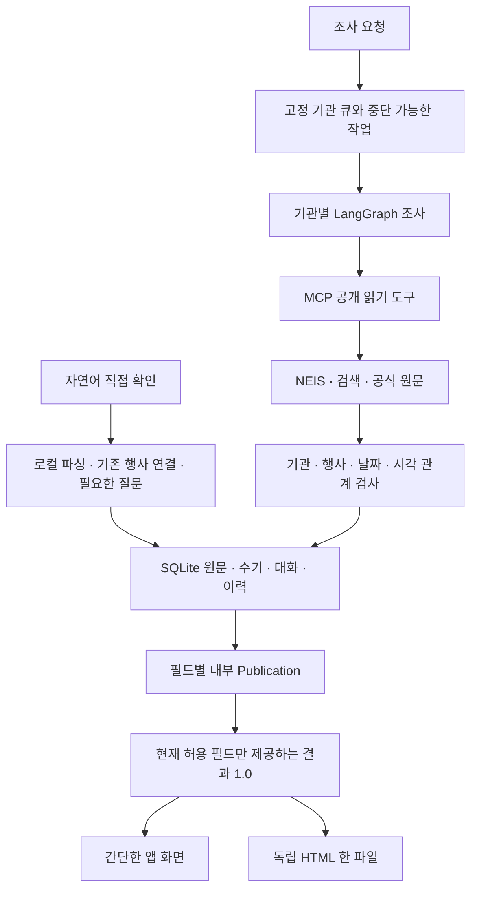

# 구조와 선택 이유

이 앱은 읽은 원문, 자동 후보, 서버가 확인한 값, 현재 출력할 수 있는 값을 구분한다. 사용자는 조사·직접 기록·단일 일정표를 사용하고, 복잡한 검증 상태와 이력은 내부에 남는다.

## 전체 흐름

## 주요 모듈

| 모듈 | 책임 |
| --- | --- |
| `launcher.py`, `__main__.py` | 로컬 실행·동일 저장소 중복 실행 방지·포트 선택·종료 |
| `config.py`, `configuration.py` | 기본값→선택 모델 profile→비어 있지 않은 `.env`→프로세스 설정, 비밀 분리 |
| `api.py`, `domain.schema.json`, `openapi.contract.json` | 계약 검증·토큰/Host/Origin·revision·멱등성·API |
| `jobs.py`, `research.py`, `tool_boundary.py` | 영속 조사 큐·누적 한도·LangGraph 반복·읽기 전용 MCP |
| `providers.py`, `registry.py`, `official_registry.py` | 실제 자료원·공식 기관/홈페이지 관계·안전한 공개 URL |
| `identity.py`, `rules.py`, `publication.py` | 행사 연결·버전별 원문 검증·현재 필드 사용 권한 |
| `storage.py`, `manual.py`, `migrations.py` | SQLite 거래·수기 보호·근거/수정 이력·백업·추가 구조 확장 |
| `natural.py` | 로컬 자연어 기록·실제 확인시점·부분 저장·추가 질문·기존 행사 갱신 |
| `results.py`, `exporting.py`, `static/schedule.*` | 요청 기관 기준의 네 열 결과·동일 오프라인 필터·페이지 이동 |

## 근거를 연결하는 방식

같은 기관·과정·캠퍼스·명시 회차를 행사 식별의 기준으로 사용한다. 날짜와 자료원 URL은 행사 정체성이 아니다. 따라서 NEIS와 HTML이 같은 졸업식을 다른 날짜로 알리면 두 행사를 만드는 대신 날짜 충돌을 남긴다. 특수학교의 초등·중등·고등·유치원·전공과나 명시 회차가 다르면 따로 유지한다. 여러 행사와 연결될 수 있으면 새 중복을 만들지 않고 확인을 요청한다.

명시 공지 규칙은 기관명과 행사 명사구, 날짜 연결어, 시각의 주어를 검사한다. `초등학교 병설유치원 졸업식`, `졸업식 준비 설명회`, `식전 공연 10시 시작`은 본교 본식의 시각과 구분한다. 정상 날짜는 남기고 시각만 보류할 수 있다. 취소·미실시도 같은 기관·학년도의 행사 상태로 검증하므로 별도 URL의 공지를 반영한다. 취소를 부정한 문장이나 다른 기관·부대행사의 취소를 일괄 적용하지 않는다.

같은 행사의 연기는 개최 상태를 불확실하게 만들고 기존 날짜·시각을 보류한다. 연기를 취소로 표시하거나 새 날짜를 추정하지 않는다.

원문 hash·인용·기관 관계·학년도·날짜 범위·필드·규칙 버전을 저장 및 조회 단계에서 다시 검사한다. 모델은 후보를 제안할 수 있지만 사실 승인 권한이 없다. 현재 활성 규칙은 [catalog](../config/rule-catalog.json)에 고정한다. 좁은 문법을 사용하는 만큼 지원하지 않는 공지는 수기 확인이나 규칙 확장이 필요하다.

기존 학사력 변경 규칙은 명시한 이전 날짜·새 날짜·학년도·회차·대상이 일치할 때만 해당 필드의 대체 관계를 적용한다. 과거 관측과 감사 이력은 삭제하지 않으며 새 날짜에 과거 시각을 묵시적으로 붙이지 않는다.

## 현재 결과와 내부 이력

내부 저장·검증 계약 4.0은 기존 자료와 API 호환을 위해 유지한다. 과거 확인값과 `general_visible`, `sales_ready` 같은 이전 계약 필드는 내부 이력에 남지만 새 사용자 화면의 표시 기준이 아니다.

표현 계약 1.0은 `current_allowed`인 날짜·시각만 제공한다. 시간만 문제면 날짜는 유지한다. 현재 확인된 취소·미실시는 간단히 표시하고 날짜·시각은 숨긴다. 취소 근거의 재확인이 실패했다면 과거 취소 역시 현재 확정 정보로 표시하지 않는다. 검증 시점·정책·revision·사적 메모는 HTML에 넣지 않는다.

대상은 해당 시즌의 최근 취소되지 않은 조사 요청과 직접 기록한 기관이다. 다른 요청이 전혀 없으면 최근 취소 요청을 사용한다. 이 선택은 취소 요청이 이전 결과 범위를 지우지 않게 한다. 확인값이 없는 대상도 같은 표의 미확인 행으로 제공하며 전체 등록 명부를 임의로 출력하지 않는다.

주소는 공식 명부에서 확인한 학교·캠퍼스 주소다. 장소 필드를 대신 사용하지 않는다. 다른 캠퍼스이거나 확인 근거를 상속할 수 없는 수기 프로필 주소는 미확인이다. 학교명 링크는 연결된 공식 HTML 원문을 우선하고 공식 홈페이지로 대체한다. 둘 다 없으면 가짜 URL을 만들지 않는다. API·XML·JSON·인증 쿼리는 사용자 링크에서 제외한다.

## 직접 기록

자연어 문장은 로컬 패턴 해석과 기존 기록 조회로 처리한다. 외부 모델을 쓰지 않으므로 사적 전화·메모 내용이 전송되지 않는다. API는 원문·수신시각·정규값·질문과 답변을 영속 저장한다. 이 선택은 개인 정보 전송과 모델 추측을 줄이지만 지원하는 표현 범위가 제한된다.

직접 확인 진술, 추측, 조사 요청을 나눈다. 실제 확인시각이 없으면 질문하며 `방금`처럼 사용자가 명시한 상대 시각만 수신시각에 연결한다. 생략한 연도는 시즌 안에서 유일할 때만 채운다. 기존 행사의 날짜가 현재 허용되고 시각만 새로 확인했다면 같은 UUID에 보완한다.

기존 값과 충돌하는 필드만 보류한다. 실제 재확인 시점과 근거 메모를 받아 해결하며 같은 원문을 다시 읽는 것으로 해결을 취소하지 않는다. 수기 set/clear/release/acknowledge 계약도 유지한다. 기존 수기 행을 삭제하지 않으며 자동 조사는 수기를 덮어쓰지 않는다.

## 저장과 재개

SQLite WAL·외래키·짧은 쓰기 거래를 사용한다. 한 PC에서 별도 DB 서버 없이 일관된 backup을 만들 수 있는 선택이다. 읽기 snapshot은 출력 시점의 근거와 판정을 고정한다. 외부 연결을 기다리는 동안 쓰기 거래를 잡지 않는다.

`experience_schema=1`은 자연어 기록과 이전 행사 연결 테이블을 추가한다. 기존 파일은 확장 전 backup을 생성한다. 규칙 버전 변경은 별도 backup 후 저장 원문을 다시 평가하며 원문을 새로 읽은 것처럼 확인시점을 바꾸지 않는다. 중복 연결은 관측 UUID와 원문·이전 행사·평가·수기 이력을 보존한다. 수기 활성 필드끼리 충돌하면 자동 병합하지 않는다. 핵심 schema 4.0 또는 경험 확장 버전이 지원 범위 밖이면 파일을 보존한 채 거절한다.

작업은 생성할 때 기관 목록과 관련 설정 hash를 고정한다. 생성과 재개 모두 같은 원자적 활성 작업 검사를 사용해 중단 작업이 다른 실행 중 조사와 겹치지 않는다. 설정 변경 후 재개는 제공자 초기화 전에 거절한다. 키 교체나 UI 포트는 관련 설정 hash와 무관하다.

호출 전 한도를 예약하고 실제 응답으로 정산하며 응답 비용을 모르면 예약을 유지한다. 멈춤·취소·실패·재시작도 누적 사용량을 초기화하지 않는다. 화면에서는 어머니에게 기술 한도를 계산하게 하지 않고 진행·멈춤·이어서 조사만 제공한다. 내부 예산은 그대로 집행한다.

## HTML과 보안

새 HTML을 생성한 뒤 DB의 현재 파일 포인터를 갱신한다. 이전 파일을 덮어쓰지 않으므로 DB 갱신 실패에도 마지막 정상 파일이 보존된다. 이전 표현의 파일은 보관하지만 새 결과 URL에서 재사용하지 않는다.

CSS·JS를 HTML에 내장하고 외부 리소스를 요청하지 않는다. 앱과 HTML은 같은 필터 코드로 학교명과 하루/기간 조건을 결합하고 필터 결과를 20개씩 보여준다. 조건 변경은 첫 페이지로 이동한다. 불신 텍스트는 escape하고 고정 script/style hash만 CSP에서 허용한다. 작은 화면은 같은 네 열을 읽기 쉬운 행 카드로 표시한다.

공개 URL 수집은 사설 주소·DNS 변경·리디렉트·TLS를 검사한다. 선택한 Ollama/OpenAI만 필요할 때 초기화하며 자동 대체하지 않는다. 전송 허용 설정을 유지하고 사적 입력·이미지는 모델 입력으로 만들지 않는다. 설치 편의, PPT·발표, Before/After 비교는 이번 범위에 포함하지 않는다.

검증 범위와 미검증 항목은 [이번 검증](IMPROVEMENT_VALIDATION.md)을 기준으로 판단한다.
